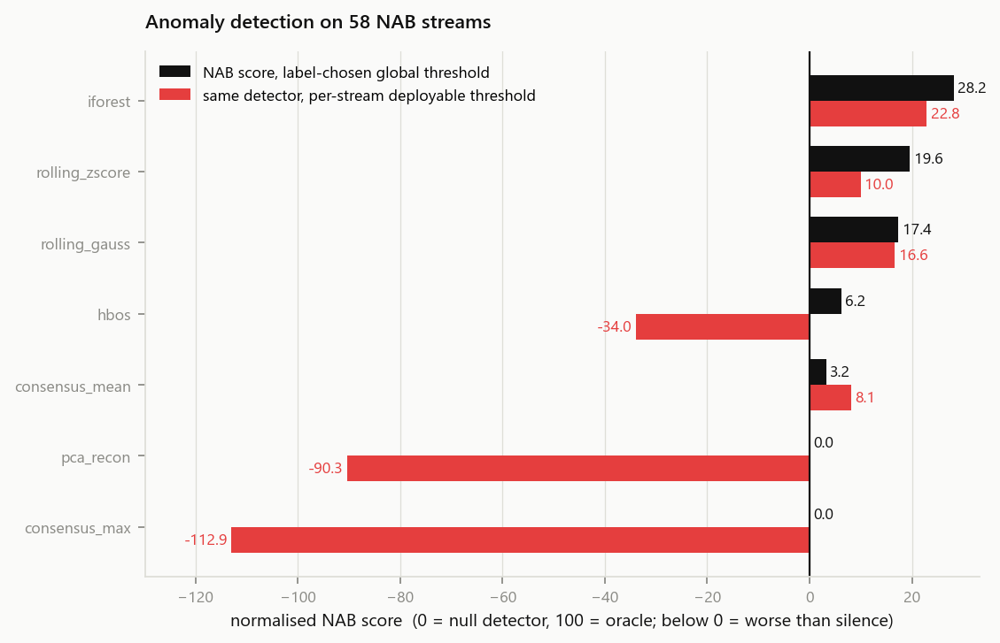
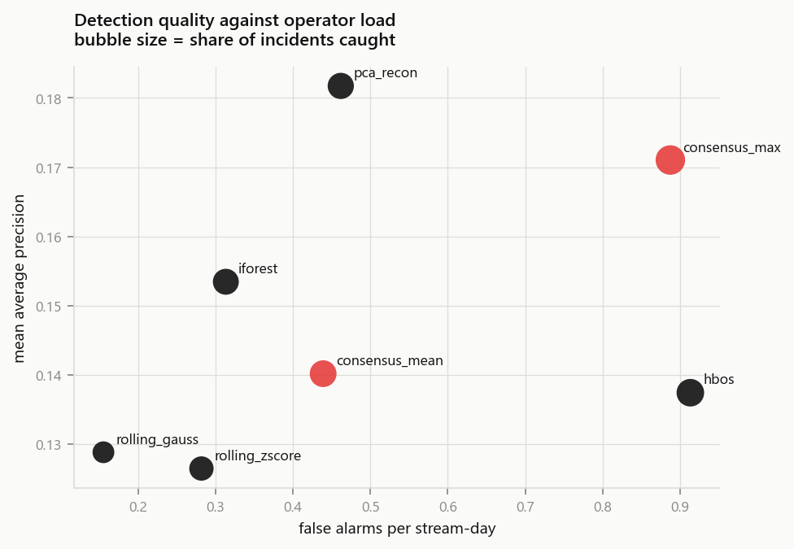
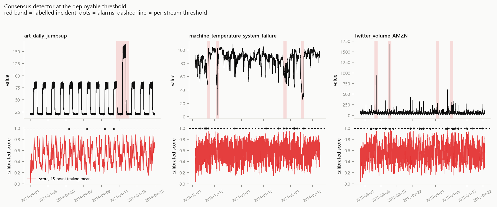
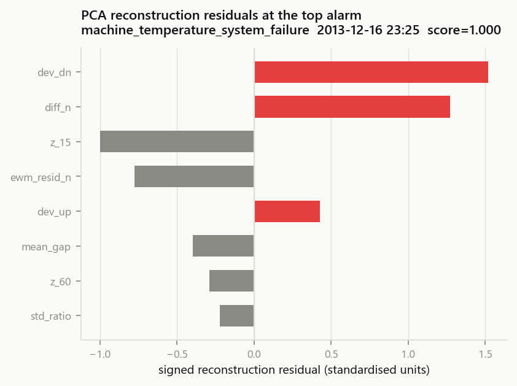

# AnomalyLab

Anomaly detection over 58 real and synthetic time series: 8 detectors, two operating
points per detector, and metrics aimed at the person who has to read the alarms.

The data and labels are [Numenta's NAB benchmark](https://github.com/numenta/NAB) — 58 streams
(AWS CPU and network counters, ad-exchange volume, tweet volumes, freeway occupancy, machine
temperatures) with 116 hand-labelled incident windows. The scoring profile is implemented in
`src/anomalylab/nab_scoring.py` from `nab/sweeper.py` in that repository (MIT), and checked
against NAB's published results before anything else in the repo was built on it.

What the repo adds on top of that: modern detectors fitted only on each stream's unlabelled
learning period, a threshold you can actually set without looking at the labels, false-alarm load
per stream-day, and the feature residuals behind each alarm.

Guneet Toppo · 2026 · MIT

---

## Results

Full run: 58 streams, 284 k rows, 116 incident windows, NAB `standard` profile, single process.
The 58-stream pass takes 6-9 minutes on one laptop CPU depending on load (last run: 388 s).

The **NAB score** runs 0–100, where 0 is a detector that never fires and 100 is an oracle that
catches every window with no false alarms. **Deployable** is the same corpus scoring at a threshold
of "99.9th percentile of the scores this detector produced during its learning period" — chosen per
stream, without labels.

| detector | NAB score | deployable | mean AP | mean precision | incidents caught | false alarms / stream-day |
|---|---|---|---|---|---|---|
| `iforest` | 28.16 | 22.83 | 0.153 | 0.265 | 64% | 0.31 |
| `rolling_zscore` | 19.59 | 9.98 | 0.126 | 0.213 | 54% | 0.28 |
| `rolling_gauss` | 17.36 | 16.64 | 0.129 | 0.150 | 41% | 0.16 |
| `hbos` | 6.18 | −33.99 | 0.137 | 0.201 | 74% | 0.91 |
| `consensus_mean` | 3.22 | 8.11 | 0.140 | 0.214 | 69% | 0.44 |
| `pca_recon` | 0.00 | −90.32 | 0.182 | 0.269 | 66% | 0.46 |
| `consensus_max` | 0.00 | −112.92 | 0.171 | 0.275 | 87% | 0.89 |
| `null` (reference) | 0.00 | 0.00 | 0.113 | — | 0% | 0.00 |

Mean AP for the null detector is 0.113, the base rate of labelled rows; that is what a detector
scores by never firing.

NAB's own published `standard` scores for comparison: ARTime 74.85, numenta 70.10, htmjava 65.55,
knncad 57.99, windowedGaussian 39.65, EXPoSE 16.44. My models are untuned and don't reach those
numbers; the repository is an evaluation harness with reasonable detectors in it, not a claim about
state of the art.









Per-series scores are in `outputs/per_series.csv`, the alarms with their evidence in
`outputs/alarms.csv`, and the whole table again in `reports/results.md`.

## How the score works

Each labelled window is worth `tpWeight` (1.0) if the detector fires inside it, and costs
`fnWeight` (1.0) if it never does. A hit is worth `scaledSigmoid(position in window)`: 1.0 at the
start of the incident, 0.0 at its right edge, so early detection is worth more. Every false
positive costs `fpWeight` (0.11) times a sigmoid of its distance past the most recent window, which
makes near misses cheap and late ones expensive.

The corpus score sums all files at a single global threshold, then rescales so a null detector is 0
and an oracle is 100. A single global threshold is NAB's convention (one detector, one setting, 58
streams) and it is the part of the protocol that causes the most surprising results below.

`scripts/validate_scorer.py` runs NAB's own shipped per-file score columns through my
implementation:

```
windowedGaussian  files=58  max|file diff|=4.98e-12  ours=39.6495  NAB=39.6495
random            files=32  max|file diff|=3.08e+00  ours=16.8318  NAB=16.8318
numenta           files=58  max|file diff|=4.98e-12  ours=70.1011  NAB=70.1011
```

Corpus scores agree to the last digit for all three. The `random` per-file rows disagree because
NAB's shipped `random` results cover fewer rows than the data files (their TN counts don't add up to
their own `Total_Count`), so only its corpus score is a real check.

## Detectors

All models are unsupervised and see only the first 15% of each stream (NAB's learning period,
capped at 750 rows).

| detector | what it scores |
|---|---|
| `rolling_zscore` | absolute z-score over a 15-row window, 3-point smoothing |
| `rolling_gauss` | two-sided Gaussian tail probability of the newest value against the previous 60 rows, as −log10 p |
| `iforest` | Isolation Forest (200 trees) over a 9-column causal feature matrix |
| `pca_recon` | squared reconstruction error from PCA (k=3) fitted on the learning period; per-feature residuals kept as evidence |
| `hbos` | 20-bin histogram per feature, mean −log p across features |
| `consensus_mean` | mean of the four calibrated members above; needs broad agreement |
| `consensus_max` | max of the four; OR-fusion, catches more and alarms more |

## Evaluation setup

**Prefix-only fitting.** Tree structures, the PCA basis, the histograms and every standardisation
statistic come from the learning period and nowhere else. No fit path reads a row that is later
scored.

**Causal, drift-invariant features.** Each of the 9 columns is a short-window statistic divided by a
long-window one: rolling z-scores at 5/15/60 points, deviation from the 60-point max and min,
short-versus-long mean gap, log ratio of standard deviations, normalised first difference and an
EWMA residual. Absolute levels are excluded on purpose — standardised on the learning period they
stay extreme after a persistent step change, and every row after the step becomes a false alarm.
A test mutates future values and asserts the past columns don't move.

**Calibration.** Raw scores are on incomparable scales (−log10 p, reconstruction error, tree
depth), so each is mapped through a Gaussian-kernel CDF built from its own learning-period scores:
the score becomes the probability that a typical normal row scores below it. The kernel is what
makes this usable — a hard empirical CDF quantises scores into 1/750 steps, which pushes every
extreme row to exactly 1.0 and leaves NAB's single global threshold unable to rank them. The grid
is built from score quantiles rather than a uniform range, so streams with 1e6-scale outliers don't
lose resolution in the region that matters.

**Thresholds.** The deployable threshold is the 99.9th percentile of the *raw* score during the
learning period — an exact quantile, per stream. Probability-scale scores saturate near 1 and make
poor cut-offs, which is why the threshold is taken before calibration.

## Notes from building it

**A single global threshold can zero a good detector.** `pca_recon` and `consensus_max` score
exactly 0.00 under NAB's convention, because the optimiser would rather fire never than pick one
threshold for all 58 streams. The same two detectors hold the best average precision in the table
(0.182 and 0.171) and catch 66% and 87% of incidents. Per-stream thresholds move the score, but
they also expose the false alarm cost, which is what the deployable column shows.

**Precision and NAB score disagree.** `consensus_max` has the best mean precision and the worst
deployable score. OR-fusion buys recall and pays in false positives; mean-fusion does the opposite.
Both are in the table rather than one being picked silently.

**Prefix-calibrated thresholds fail on drifting streams.** A single EC2 network stream accounts
for 1 289 false-positive rows for `pca_recon` (32% of that stream) because its post-learning-period
behaviour differs from the first 604 rows. The NAB score only looks mediocre; the alarms-per-day
column points at the stream.

**Point recall is the wrong column.** Incident windows run to hundreds or thousands of rows (566
rows each for the machine-temperature incidents), so mean recall is around 0.008 while 64% of
incidents are caught. One hit inside a window earns it.

## Running it

```bash
pip install -r requirements.txt          # or pip install -e .

python scripts/download_data.py          # 9 MB corpus, +76 MB NAB reference results
python scripts/validate_scorer.py        # scorer vs NAB's published numbers
python scripts/run_benchmark.py          # 58 streams x 8 detectors, ~7 min
python scripts/make_reports.py           # figures -> reports/
python -m unittest discover -s tests -v  # 9 tests
```

Options: `--quantile 0.995`, `--profile reward_low_FP_rate`, `--detectors iforest,pca_recon`,
`--limit N`, `--out-dir DIR` (keeps smoke runs out of `outputs/`).
`download_data.py --data-only` skips the 76 MB of reference results; the scorer test then skips
itself.

## Layout

```
AnomalyLab/
├── src/anomalylab/
│   ├── io.py           corpus + label loading, probation-length rule
│   ├── features.py     causal features, kernel-CDF calibration, thresholds
│   ├── detectors.py    the 7 models above + null
│   ├── nab_scoring.py  NAB's application profile (port of nab/sweeper.py)
│   ├── metrics.py      point, window and alarm-load metrics
│   └── plots.py        figures
├── scripts/            download_data, validate_scorer, run_benchmark, make_reports
├── tests/test_smoke.py 9 tests: scorer fidelity, causality, calibration
├── outputs/            per_series.csv, leaderboard.csv, alarms.csv
└── reports/            metrics.json, results.md, PNGs
```

## Data

| family | streams | anomalies |
|---|---|---|
| `artificialWithAnomaly` | 6 | injected flatlines, jumps, spikes |
| `artificialNoAnomaly` | 5 | negative controls, no windows |
| `realAWSCloudwatch` | 17 | EC2 CPU/network, one region misconfiguration |
| `realKnownCause` | 7 | documented incidents, e.g. a machine overheat |
| `realTraffic` | 7 | freeway occupancy with incidents |
| `realTweets` | 10 | tweet-volume spikes |
| `realAdExchange` | 6 | ad-click volume |

Each stream is univariate (`timestamp`, `value`), which is why the feature work is all rolling-window
statistics. `data/` and `reference/` are git-ignored; the download script reproduces them.

## Limitations

- NAB's windows mark incidents, not the exact anomalous rows, so a detection just outside a window
  is scored as a false positive. F1 and AP inherit that.
- Univariate streams limit what any model can do. The modern detectors don't dominate the rolling
  baselines here, and I don't read that as a bug.
- `rolling_gauss` is my own 60-row implementation, not NAB's tuned `windowedGaussian` (17.4 vs
  39.6). The validation script checks the scorer, not this detector.
- Window lengths (5/15/60) were fixed before any scoring ran and never tuned on the labels.
- 284 k labelled rows is a small corpus; differences of a few NAB points are noise.

## Next

- Report the score curve across threshold quantiles instead of one operating point.
- Replace the kernel CDF with a generalised-Pareto fit above the 90th percentile for proper tail
  behaviour.
- Re-estimate the reference distribution online rather than once per stream, which is what the
  drifting EC2 stream needs.

## Credits

Data, labels and reference results: [numenta/NAB](https://github.com/numenta/NAB), MIT, © Numenta
Inc. `src/anomalylab/nab_scoring.py` is derived from `nab/sweeper.py` under the same terms.
Everything else is mine, MIT licensed (see `LICENSE`).
