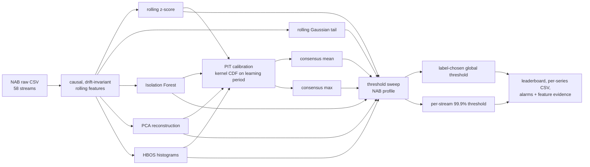

# AnomalyLab — a leakage-aware rebuild of the NAB benchmark

The [Numenta Anomaly Benchmark](https://github.com/numenta/NAB) is the standard
benchmark for streaming anomaly detection: 58 real and synthetic time series
(AWS CPU/network, ad-exchange traffic, tweet volumes, machine temperatures),
116 hand-labelled incident windows, and an application-oriented score that
rewards early detection and penalises false alarms.

It is also a 2015 benchmark. Its reference detectors are HTM / EXPoSE / windowed
Gaussian, its reported score is chosen *with the labels*, and it says nothing
about how many alarms an operator would actually have to look at.

This repository keeps NAB's data and NAB's scoring profile — re-implemented and
verified against NAB's own published numbers to 5e-12 — and adds four things NAB
does not do:

1. **Modern detectors on the same corpus.** Isolation Forest, PCA reconstruction
   error and HBOS over a causal, drift-invariant rolling feature matrix, plus two
   PIT-calibrated fusions of those detectors.
2. **A deployable operating point.** Fire above the 99.9th percentile of the
   scores the detector produced during its own unlabelled learning period. Per
   stream, no labels, no tuned constant — reported next to NAB's label-chosen
   optimum so the gap between "possible" and "deployable" is visible.
3. **Operator-facing metrics.** False alarms per stream-day, share of incidents
   caught, detection delay and mean average precision alongside the NAB score.
4. **Per-alarm evidence.** The feature residuals behind each PCA/HBOS alarm
   instead of an opaque number.

---

## Results

58 streams, 116 labelled windows, NAB `standard` profile, deployable threshold =
99.9th percentile of the learning period. Numbers come from
`outputs/leaderboard.csv`, regenerated by `scripts/run_benchmark.py`
(runtime 523 s on this CPU, single process).

| detector | NAB score | NAB score @ deployable thr. | mean AP | mean precision | incidents caught | false alarms / stream-day |
|---|---|---|---|---|---|---|
| `iforest` | **28.16** | **22.83** | 0.153 | 0.265 | 64% | 0.31 |
| `rolling_zscore` | 19.59 | 9.98 | 0.126 | 0.213 | 54% | 0.28 |
| `rolling_gauss` | 17.36 | 16.64 | 0.129 | 0.150 | 41% | 0.16 |
| `hbos` | 6.18 | −33.99 | 0.137 | 0.201 | 74% | 0.91 |
| `consensus_mean` | 3.22 | 8.11 | 0.140 | 0.214 | 69% | 0.44 |
| `pca_recon` | 0.00 | −90.32 | **0.182** | 0.269 | 66% | 0.46 |
| `consensus_max` | 0.00 | −112.92 | 0.171 | 0.275 | **87%** | 0.89 |
| `null` (reference) | 0.00 | 0.00 | 0.113 | 0.000 | 0% | 0.00 |

`mean AP` for the null detector equals the base rate of labelled rows (0.113),
which is what a detector that never fires gets for free.

For orientation, NAB's own published `standard`-profile scores are ARTime 74.85,
numenta 70.10, htmjava 65.55, knncad 57.99, windowedGaussian 39.65, EXPoSE 16.44.
**This project does not beat NAB.** It is a deliberately untuned modern baseline,
scored under NAB's protocol, and it loses to a decade of NAB-specific tuning —
which is the honest number to report, not a selective one.


---

## Four things this build makes visible

**1. NAB's single global threshold is a real constraint, not a detail.**
NAB picks one threshold per detector for the entire corpus. `pca_recon` and
`consensus_max` score **0.00** under that convention — the optimiser prefers
"never fire" to any global cut — while catching 66% and 87% of incidents and
having the two best AP values of the whole table. Their per-stream columns are
still negative, because catching incidents with a prefix-calibrated threshold on
58 heterogeneous streams means accepting false alarms that NAB's profile prices
at 0.11 each. A single number hides all of this; a table does not.

**2. Precision is not the metric to optimise on a 0.1%-firing budget.**
`consensus_max` has the best mean precision (0.275) and the worst deployable NAB
score. The pattern is the point of the exercise: recall-oriented fusion buys
incidents and pays in false positives, mean-fusion does the opposite, and NAB's
score prices that trade rather than resolving it.

**3. A prefix-calibrated threshold breaks on drifting streams, visibly.**
`ec2_network_in_257a54` alone contributes 1 289 false-positive rows for
`pca_recon` (32% of that stream) because its post-learning-period behaviour
diverges from the first 604 rows. The per-stream-day alarm load is what exposes
this; the corpus NAB score alone would just look mediocre.

**4. Point-level recall is nearly meaningless on NAB windows.**
Windows span thousands of rows (the machine-temperature incidents are 566 rows
each), so `mean recall ≈ 0.008` even when 64% of incidents are caught — a
detector needs one hit inside a window to earn it. "Incidents caught" is the
column an operator should read.

---

## What the NAB score is, in one paragraph

For every labelled window a detector either earns `tpWeight` (1.0) or pays
`fnWeight` (1.0); a hit is worth `scaledSigmoid(position in window)`, so an alarm
at the start of an incident is worth 1.0 and one at its right edge is worth 0.0.
Every false positive pays `fpWeight` (0.11) times a sigmoid of its distance past
the most recent window — near misses are cheap, late ones saturate. The corpus
score is the sum over all files at one global threshold, rescaled so a null
detector scores 0 and an oracle scores 100.

`src/anomalylab/nab_scoring.py` is a port of `nab/sweeper.py`.
`scripts/validate_scorer.py` feeds NAB's own shipped per-file `anomaly_score`
columns through it and reports:

```
windowedGaussian  files=58  max|file diff|=4.98e-12  ours=39.6495  NAB=39.6495
random            files=32  max|file diff|=3.08e+00  ours=16.8318  NAB=16.8318
numenta           files=58  max|file diff|=4.98e-12  ours=70.1011  NAB=70.1011
```

Corpus scores match to the last digit for all three detectors. The `random`
per-file rows disagree because NAB's shipped `random` results cover fewer rows
than the data files (their TN counts do not add up to their own `Total_Count`),
so only its corpus score is meaningful.

## Pipeline



## Data

`scripts/download_data.py` fetches all 58 series (9.3 MB) plus
`labels/combined_windows.json` and, for validation only, NAB's published results
for `windowedGaussian`, `numenta` and `random`. `data/` and `reference/` are
git-ignored and reproducible from that script.

| family | streams | what the anomalies are |
|---|---|---|
| `artificialWithAnomaly` | 6 | injected flatlines, jumps, spikes |
| `artificialNoAnomaly` | 5 | negative controls (no windows) |
| `realAWSCloudwatch` | 17 | EC2 CPU/network, one region misconfiguration |
| `realKnownCause` | 7 | documented incidents, e.g. a machine overheat |
| `realTraffic` | 7 | freeway occupancy with incidents |
| `realTweets` | 10 | tweet-volume spikes |
| `realAdExchange` | 6 | ad-click volume |

Every stream is univariate (`timestamp`, `value`), which is why the feature
engineering is rolling-window based — there is no second channel to lean on.

## Repository layout

```
NAB-AnomalyLab/
├── data/                        58 raw NAB series (downloaded)
├── labels/combined_windows.json  ground-truth windows
├── reference/                   NAB's published results, used by the scorer test
├── src/anomalylab/
│   ├── io.py                    corpus + label loading, probation-length rule
│   ├── features.py              causal drift-invariant features, PIT, thresholds
│   ├── detectors.py             z-score, Gaussian tail, IF, PCA, HBOS, fusions
│   ├── nab_scoring.py           port of NAB's application profile
│   ├── metrics.py               point / window / alarm-load metrics
│   └── plots.py                 figures
├── scripts/
│   ├── download_data.py         fetch corpus + reference results
│   ├── validate_scorer.py       our scorer vs NAB's published numbers
│   ├── run_benchmark.py         full 58-stream benchmark (~9 min)
│   └── make_reports.py          figures + reports/results.md
├── outputs/                     per_series.csv, leaderboard.csv, alarms.csv
├── reports/                     metrics.json, results.md, PNG figures
└── tests/test_smoke.py          9 tests: scorer fidelity, causality, calibration
```

## Design decisions and why

**Everything is fitted on the learning period only.** NAB reserves the first 15%
of each file (capped at 750 rows) as an unlabelled probation period. The
Isolation Forest trees, the PCA basis, the HBOS histograms and every
standardisation statistic are fitted there and nowhere else. No fit path touches
a row that is later scored, and no fit path touches a label.

**Features are ratios, never levels.** Every column is a short-window statistic
divided by a long-window one (rolling z-scores, deviations from the 60-point
max/min, short-vs-long mean gap, log std ratio). An absolute `level` column
standardised on the learning period stays extreme forever after a persistent
step change, so every row after the step becomes a false alarm. Removing those
columns cut corpus false alarms by roughly half on the artificial streams without
losing a single incident. A test mutates future values and asserts that past
features are unchanged.

**Calibration is a kernel CDF, not an empirical one.** Raw scores live on
incomparable scales (−log10 p, reconstruction error, tree depth). Each is mapped
through a Parzen CDF of *its own learning-period scores*, so every score is the
probability that a typical normal row scores below it. A hard empirical CDF
quantises scores into 1/750 steps, which collapses every extreme row onto exactly
1.0 — and then NAB's single corpus-wide threshold cannot rank them at all. The
kernel version is continuous and strictly increasing. Its evaluation grid is
built from score quantiles, not a uniform linspace, because a uniform grid over a
series with 1e6-scale outliers puts no resolution where the learning-period
scores actually live and silently turns a 0.1% threshold into a 1.6% one.

**Thresholds are raw quantiles, not calibrated values.** A probability-scale
score saturates near 1 and is useless as a cut-off; the deployable threshold is
the 99.9th percentile of the *raw* score during the learning period, an exact
quantile, so "fire above it" means "fire on the top 0.1% of what this stream
looked like before we started watching".

**A constant stream maps to zero, not to ranks.** A flatlined sensor makes every
score identical; ranking identical values turns a dead sensor into a perfect ramp
of anomalies (this happened: 3 332 alarms on `art_flatline` before the fix). The
calibration now returns 0 for a degenerate reference distribution.

**The fusions are equal-weight, not fitted.** Fitting weights would need
something to fit against, and under an unsupervised protocol the only clean data
is the learning period, which has nothing to fit. `consensus_mean` requires broad
agreement; `consensus_max` is OR-fusion. Both are reported so the trade-off is
visible rather than baked in.

## Getting started

```bash
# Python 3.13 with pandas / numpy / scikit-learn / scipy / matplotlib
python scripts/download_data.py        # ~9 MB, one-time, ~1 min
python scripts/validate_scorer.py      # scorer fidelity vs NAB's own results
python scripts/run_benchmark.py        # 58 streams x 8 detectors, ~9 min CPU
python scripts/make_reports.py         # figures -> reports/
python -m unittest discover -s tests -v
```

`run_benchmark.py` also takes `--quantile 0.995`, `--profile reward_low_FP_rate`
and `--limit N` for quick iterations.

## Caveats

- **The labels are approximate.** NAB windows mark incidents, not the exact
  anomalous rows; a detection one row outside a window is scored as a false
  positive. Every F1/AP number here inherits that noise floor.
- **Univariate streams cap the ceiling.** With one channel there is no
  multivariate structure to exploit, so modern detectors do not crush the
  classical baselines — the honest conclusion, not the flattering one.
- **My `rolling_gauss` is not NAB's `windowedGaussian`.** It is a simplified
  re-implementation (60-row Gaussian tail, −log10 p) and scores 17.4 where NAB's
  tuned version scores 39.6. The validation script checks the *scorer*, not this
  detector.
- **Window size choice is untuned** (5 / 15 / 60 points). It was fixed before any
  scoring ran and deliberately not optimised on the labels.
- **The 58-series corpus is small** (284 k labelled rows); differences of a few
  points in the NAB score are not meaningful.

## Where this would go next

- Per-series thresholds are clearly better than NAB's single global one; a
  proper study would report the score curve over the threshold quantile instead
  of one operating point.
- Expected-value tail modelling (a generalised-Pareto fit above the 90th
  percentile) would replace the kernel CDF and give calibrated p-values with
  proper tail behaviour.
- Drift handling: re-estimating the reference distribution online (rather than
  once, on a prefix) is the obvious missing piece, and the per-stream-day alarm
  load shows exactly which streams need it.

## Dataset and licence

Data and reference results come from [numenta/NAB](https://github.com/numenta/NAB),
MIT licensed, © Numenta Inc. `src/anomalylab/nab_scoring.py` is derived from
`nab/sweeper.py` under the same MIT terms. Everything else here is new code.
