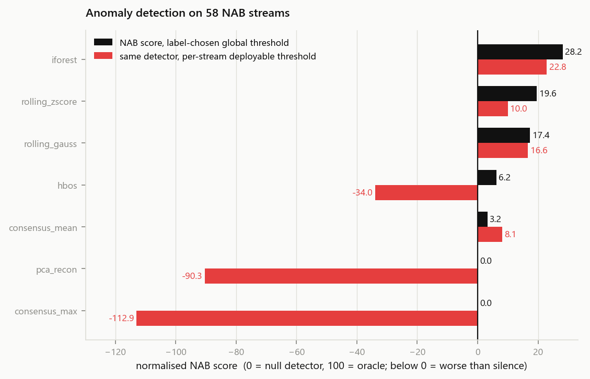
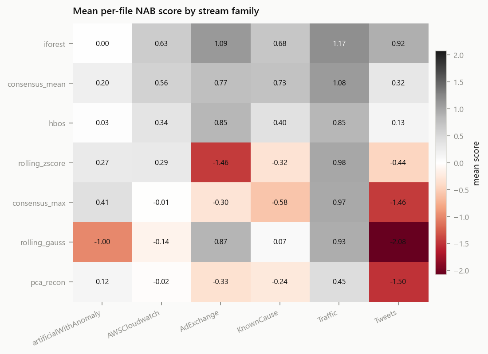
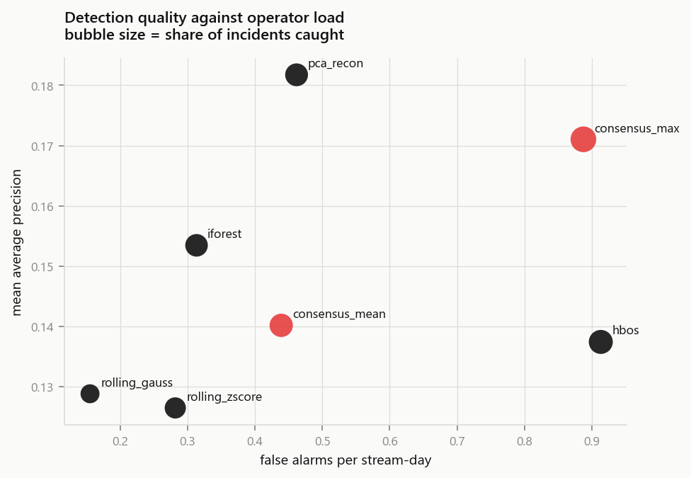
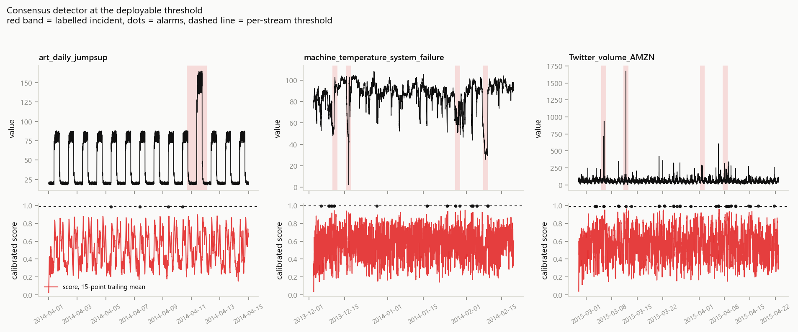
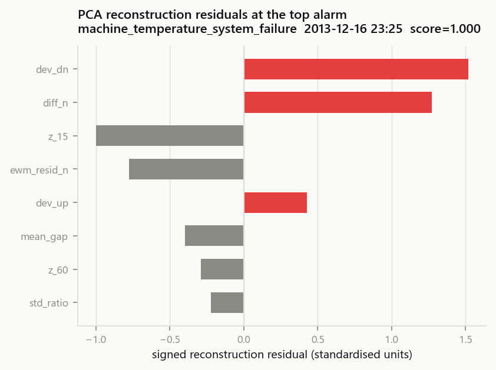

# Results

Generated by `scripts/make_reports.py` from `outputs/leaderboard.csv`.
Corpus: 3 streams, 0 labelled windows,
profile `standard`, deployable quantile 0.999, runtime 12.0s.

| detector | NAB score | NAB score @ deployable thr. | mean AP | mean precision | mean recall | incidents caught | false alarms / stream-day |
|---|---|---|---|---|---|---|---|
| `iforest` | 28.16 | 22.83 | 0.153 | 0.265 | 0.007 | 64% | 0.31 |
| `rolling_zscore` | 19.59 | 9.98 | 0.126 | 0.213 | 0.008 | 54% | 0.28 |
| `rolling_gauss` | 17.36 | 16.64 | 0.129 | 0.150 | 0.007 | 41% | 0.16 |
| `hbos` | 6.18 | -33.99 | 0.137 | 0.201 | 0.012 | 74% | 0.91 |
| `consensus_mean` | 3.22 | 8.11 | 0.140 | 0.214 | 0.010 | 69% | 0.44 |
| `null` | 0.00 | 0.00 | 0.113 | 0.000 | 0.000 | 0% | 0.00 |
| `pca_recon` | 0.00 | -90.32 | 0.182 | 0.269 | 0.038 | 66% | 0.46 |
| `consensus_max` | 0.00 | -112.92 | 0.171 | 0.275 | 0.043 | 87% | 0.89 |

